<a href="https://usmanghanics.vercel.app/">
  <picture>
    <source media="(prefers-color-scheme: dark)" srcset="assets/banner-dark.png">
    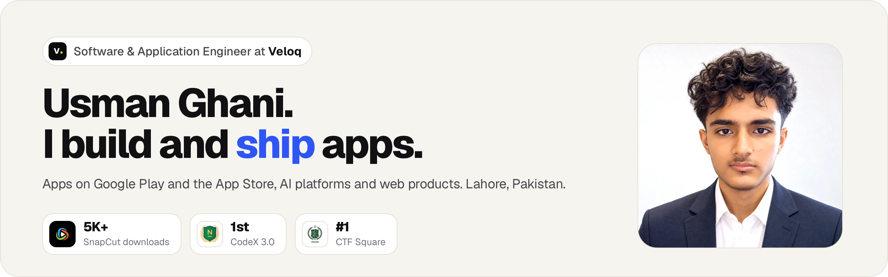
  </picture>
</a>

<a href="https://usmanghanics.vercel.app/"><picture><source media="(prefers-color-scheme: dark)" srcset="assets/link-portfolio-dark.png"></picture></a>&nbsp;
<a href="https://www.linkedin.com/in/usmanghanics"><picture><source media="(prefers-color-scheme: dark)" srcset="assets/link-linkedin-dark.png">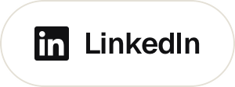</picture></a>&nbsp;
<a href="https://x.com/usmanghanics"><picture><source media="(prefers-color-scheme: dark)" srcset="assets/link-x-dark.png">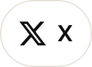</picture></a>&nbsp;
<a href="https://play.google.com/store/apps/developer?id=BlueX+Software+Solutions"><picture><source media="(prefers-color-scheme: dark)" srcset="assets/link-play-dark.png"></picture></a>&nbsp;
<a href="mailto:usmanghanics.dev@gmail.com"><picture><source media="(prefers-color-scheme: dark)" srcset="assets/link-email-dark.png"></picture></a>

I'm a software engineer in Lahore. I build mobile apps that are live on Google Play and the App Store, and AI platforms and web products for companies. I work at [Veloq](https://veloq.tech/), an AI software house, and study computer science at Namal University.

### Apps I've shipped

<a href="https://usmanghanics.vercel.app/work/snapcut"><picture><source media="(prefers-color-scheme: dark)" srcset="assets/app-snapcut-dark.png">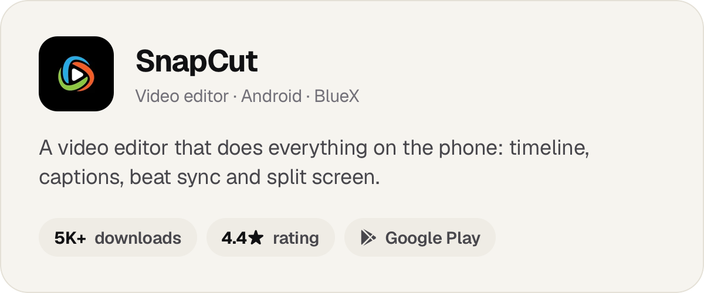</picture></a>
<a href="https://usmanghanics.vercel.app/work/makki-autocare"><picture><source media="(prefers-color-scheme: dark)" srcset="assets/app-makki-dark.png">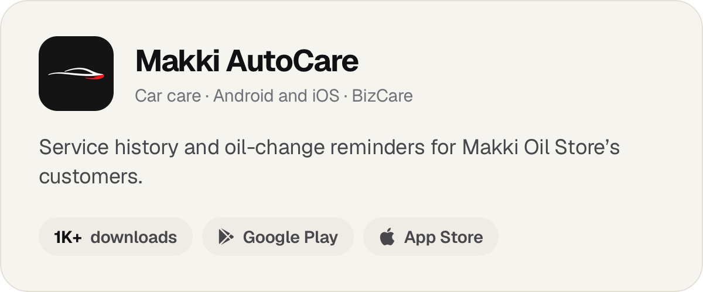</picture></a>

<a href="https://usmanghanics.vercel.app/work/madadgar-kisan"><picture><source media="(prefers-color-scheme: dark)" srcset="assets/app-madadgar-dark.png">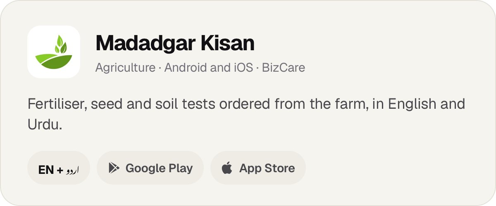</picture></a>
<a href="https://usmanghanics.vercel.app/work/bizcare"><picture><source media="(prefers-color-scheme: dark)" srcset="assets/app-bizcare-dark.png">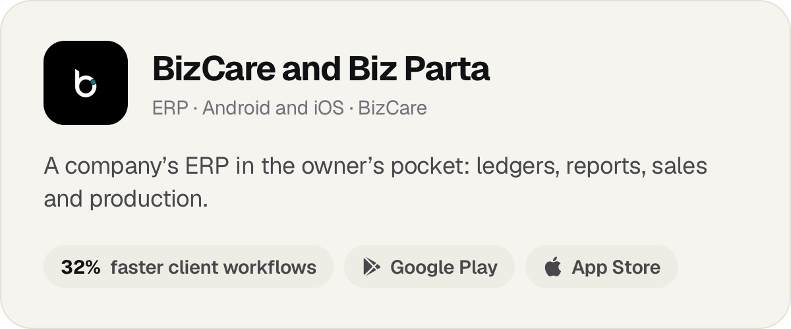</picture></a>

### Platforms I've built

<a href="https://bizcare.pk/"><picture><source media="(prefers-color-scheme: dark)" srcset="assets/web-bizcarepk-dark.png">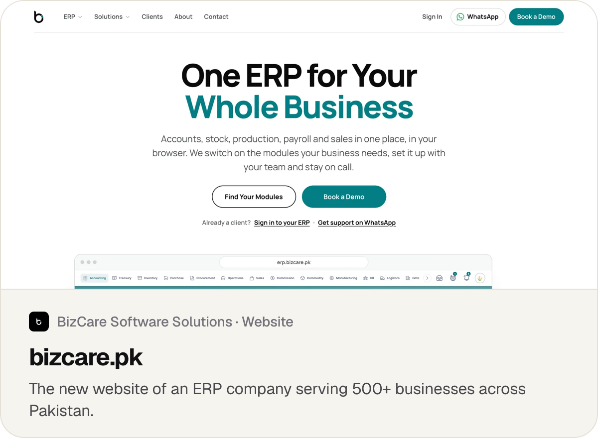</picture></a>
<a href="https://www.leafyio.io/"><picture><source media="(prefers-color-scheme: dark)" srcset="assets/web-leafyio-dark.png">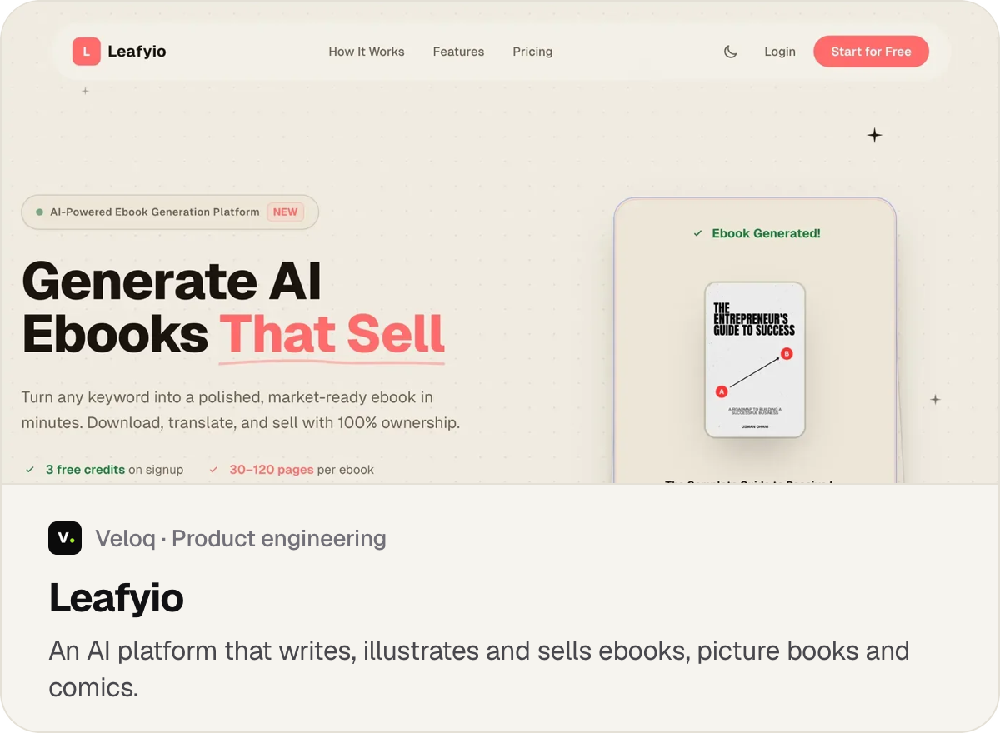</picture></a>

<a href="https://auto-scale-agents-web.vercel.app/"><picture><source media="(prefers-color-scheme: dark)" srcset="assets/web-autoscale-dark.png">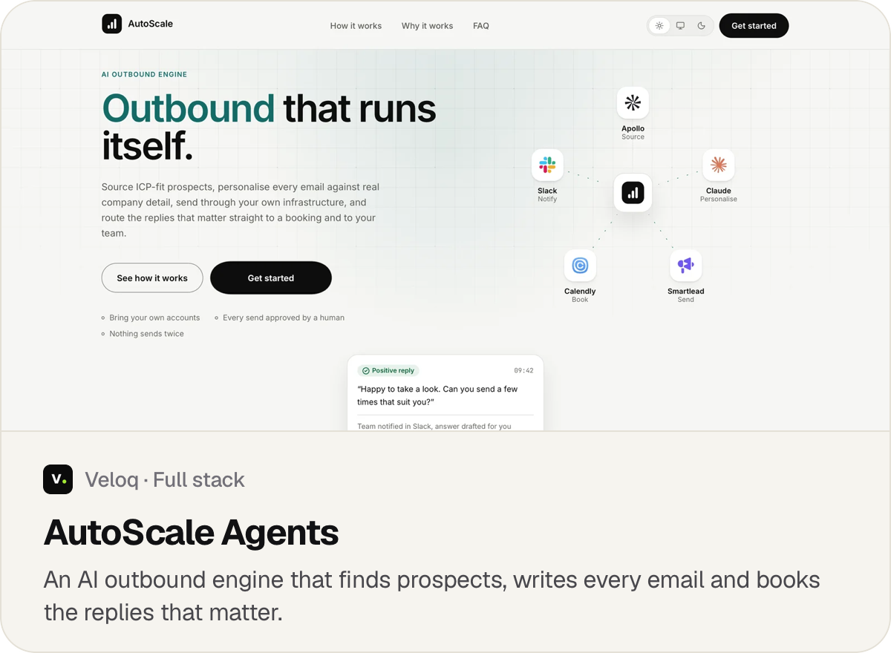</picture></a>
<a href="https://harbor.veloq.tech/"><picture><source media="(prefers-color-scheme: dark)" srcset="assets/web-talentpool-dark.png">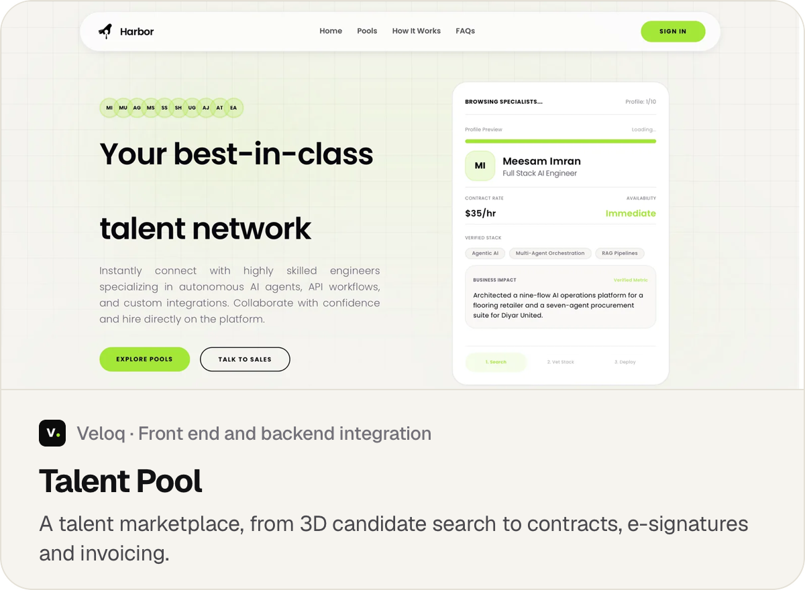</picture></a>

### Where I've worked

<a href="https://usmanghanics.vercel.app/#experience"><picture><source media="(prefers-color-scheme: dark)" srcset="assets/work-dark.png">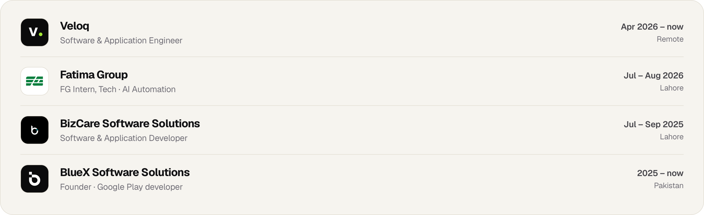</picture></a>

### Education

<a href="https://usmanghanics.vercel.app/about"><picture><source media="(prefers-color-scheme: dark)" srcset="assets/education-dark.png">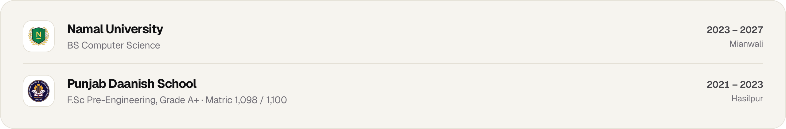</picture></a>

### Awards and rankings

<a href="https://usmanghanics.vercel.app/#achievements"><picture><source media="(prefers-color-scheme: dark)" srcset="assets/awards-dark.png">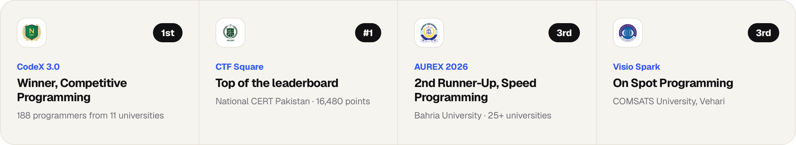</picture></a>

### Tools I ship with

<a href="https://usmanghanics.vercel.app/#stack"><picture><source media="(prefers-color-scheme: dark)" srcset="assets/tools-dark.png">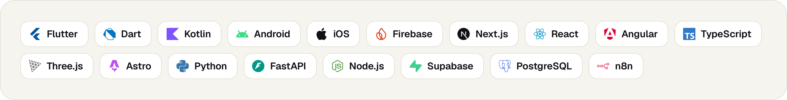</picture></a>

Case studies, certificates and more at <a href="https://usmanghanics.vercel.app/">usmanghanics.vercel.app</a>

